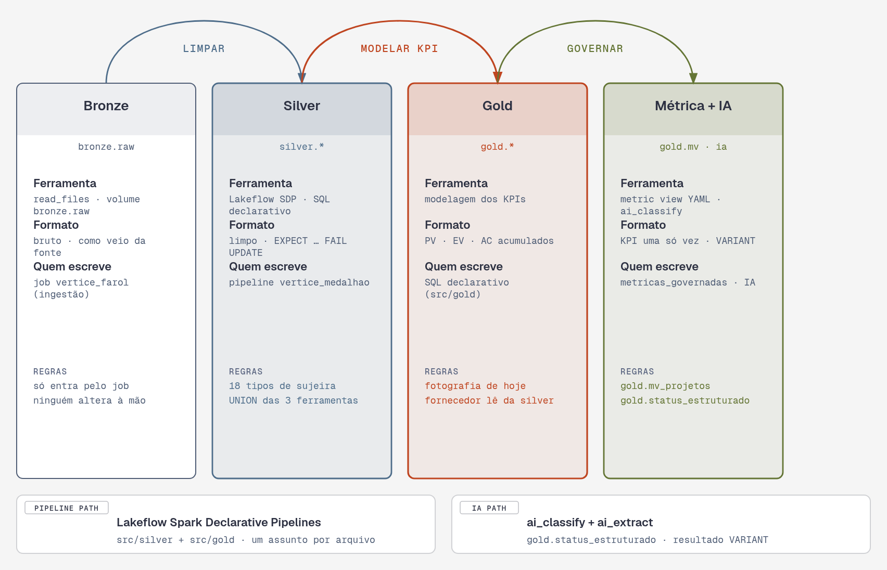
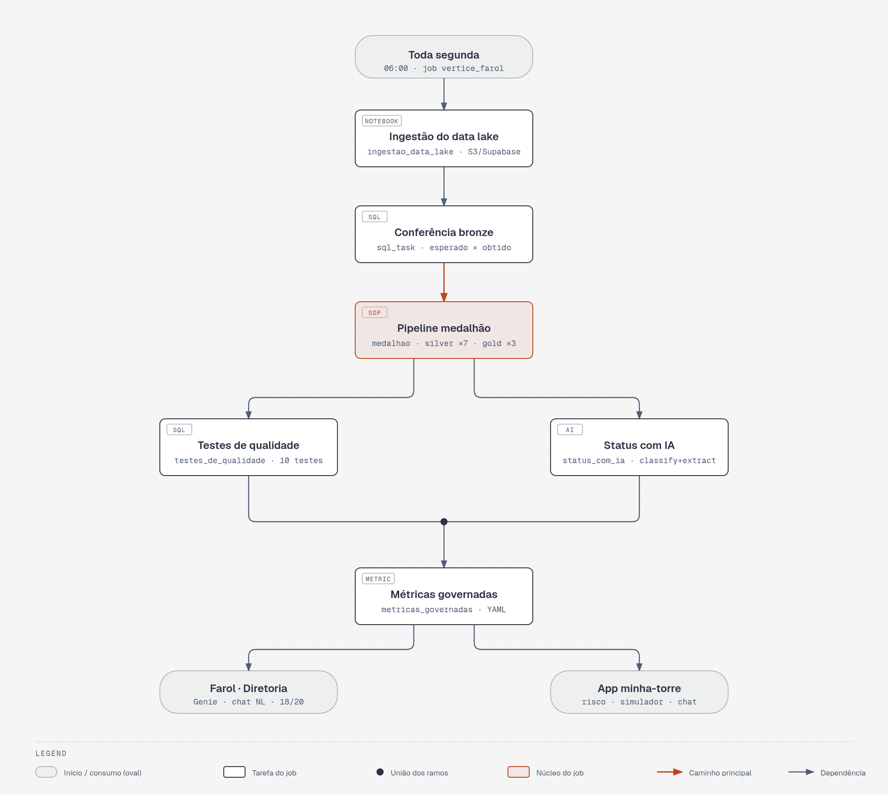
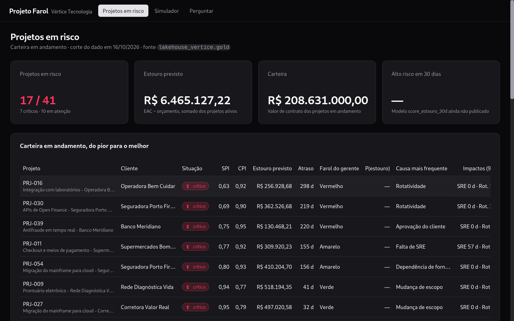
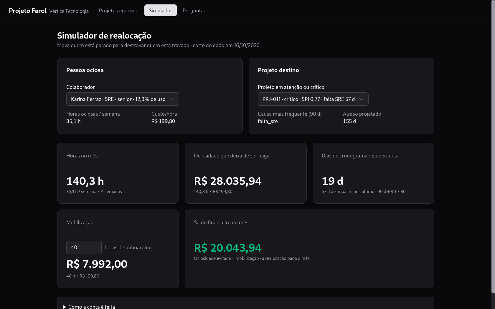
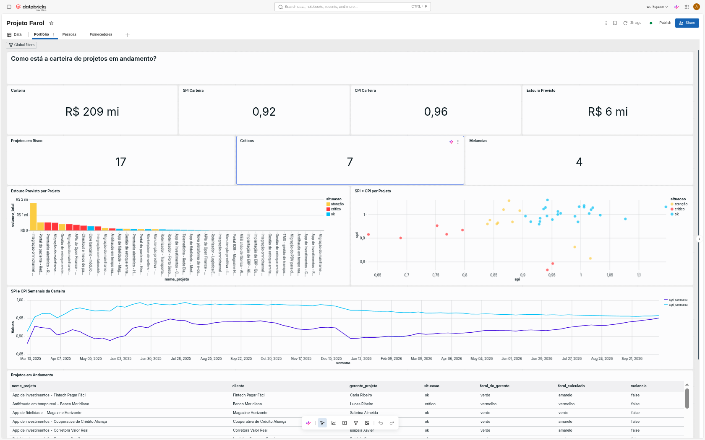
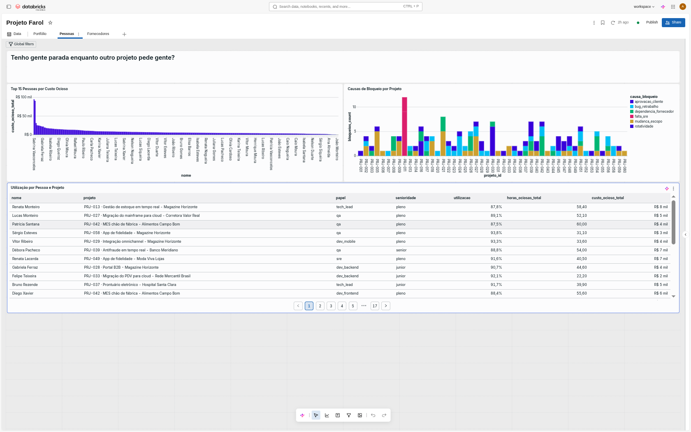
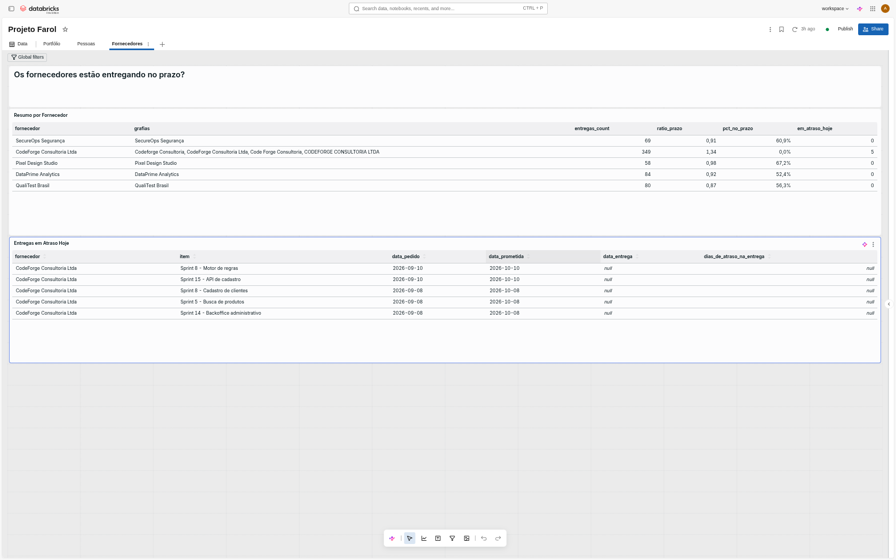
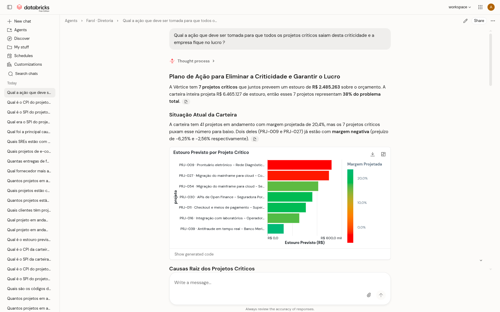
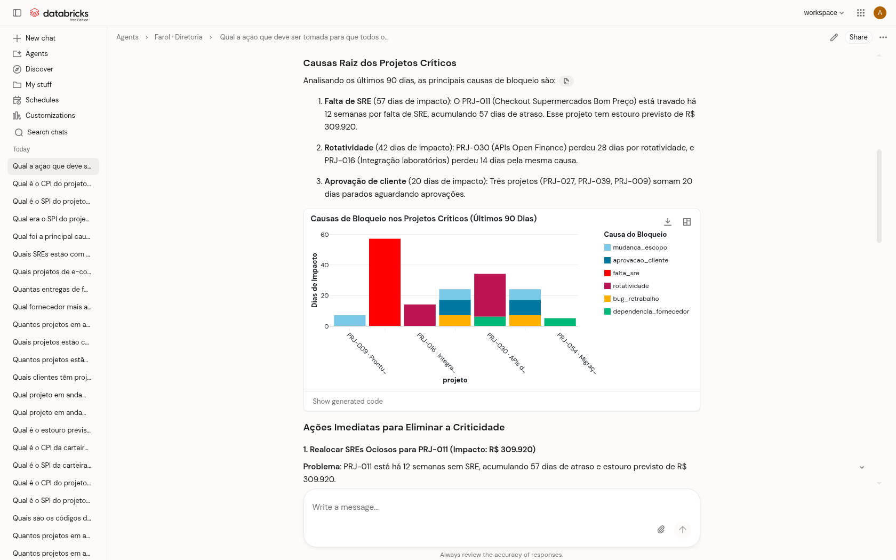
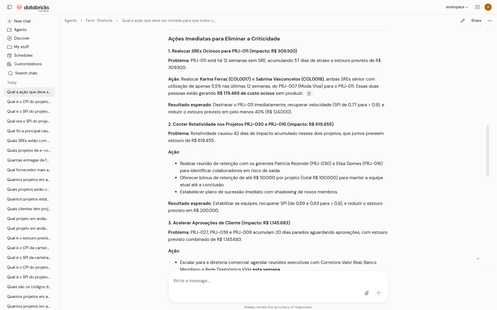

# Projeto Farol · Imersão Databricks + Claude Code

> **Torre de Controle da Vértice Tecnologia**: um lakehouse que responde, em uma página e
> em uma pergunta em português, *quais projetos vão atrasar, quanto isso vai custar, onde
> está gente parada e o que vai dar errado no próximo mês.*

Construído na [Imersão Jornada de Dados](https://github.com/lvgalvao/ImersaoControlTower)
com **Databricks** (Lakeflow, Unity Catalog, AI Functions, Genie, Apps) orquestrado por um
**bundle declarativo (DABs)** — e com o Claude Code escrevendo o código todo, prompt a prompt
(`prompts/prompt_01.md` a `prompts/prompt_06.md`).

---

## O problema

A **Vértice Tecnologia** desenvolve e implanta sistemas para grandes clientes de varejo,
financeiro, saúde, logística e indústria: **60 projetos, 520 pessoas, R$ 305 mi de carteira**.
O time de dados é uma pessoa só, que acumula os quatro papéis.

A origem de tudo: cada gerente controla o projeto na ferramenta que bem entende —
**20 planilhas Excel, 25 no ClickUp e 15 no MS Project** — e o status semanal chega como
**texto livre** ("ver ata da reunião", "parado por decisão do cliente"). O PMO não consegue
dizer quais projetos estão atrasados, quanto um atraso custa, ou onde existe gente ociosa
enquanto outro projeto precisa de gente.

**As quatro perguntas do dono**, que a Torre responde:

1. **Quais projetos estão atrasados, e de quais clientes?** → SPI, CPI e situação em `gold.mv_projetos` (métrica governada) e `gold.projeto_situacao_atual`
2. **Quanto esse atraso vai me custar?** → EAC, estouro previsto e margem projetada
3. **Tenho gente parada enquanto outro projeto pede gente?** → `silver.apontamentos` (timesheet) × `gold.status_estruturado` (causa, extraída por IA)
4. **O que vai dar errado no próximo mês?** → entregas de consultoria atrasadas (`silver.entregas_fornecedor` + **score do modelo**) e o **change freeze da Black Friday** (01/11/2026–10/01/2027)

### Regras de negócio

| Regra | Definição |
|---|---|
| Cortes de situação | SPI ou CPI **< 0,9** = `atenção`; **< 0,8** = `crítico` |
| Farol calculado | verde com SPI ≥ 0,95; amarelo ≥ 0,90; vermelho abaixo |
| Melancia | farol do gerente **verde** com SPI **< 0,9** |
| SPI | EV ÷ PV (horas × % concluído ÷ horas × % do prazo baseline decorrido) |
| CPI | EV ÷ AC, com EV = orçamento × horas agregadas ÷ horas totais |
| EAC / Estouro | orçamento ÷ CPI; estouro = EAC − orçamento (só quando positivo) |
| Atraso projetado | duração baseline ÷ SPI − duração baseline (dias) |

> **O "hoje" do dataset é `DATE'2026-10-16'`.** Nenhuma query usa `current_date()`:
> o número mudaria todo dia e não bateria entre sistemas (metric view, Genie, dashboard e app).

---

## Arquitetura de dados (medalhão)

O lakehouse é um catálogo só — **`lakehouse_vertice`**, no Unity Catalog — com três
camadas encadeadas:



Toda segunda às 06:00 o job orquestrador **`vertice_farol`** roda as 6 tarefas
em sequência, com um par de ramos paralelos na validação e um par de consumidores na ponta:



### Camadas

| Camada | O que tem | Regras |
|---|---|---|
| **Bronze** | 9 tabelas brutas: os 3 formatos de tarefas, status semanal como texto, custos com vírgula decimal | Só entra pelo job de ingestão; ninguém altera à mão |
| **Silver** | `projetos`, `tarefas`, `status_semanal`, `custos`, `colaboradores`, `apontamentos`, `entregas_fornecedor` | Toda a limpeza (18 tipos de sujeira proposital no dataset); qualidade com `CONSTRAINT … EXPECT … ON VIOLATION FAIL UPDATE`; **a integração das 3 ferramentas mora em `silver.tarefas`** |
| **Gold** | `fato_projeto_semana` (PV/EV/**AC acumulados** por semana), `projeto_situacao_atual` (fotografia de hoje, já com o cadastro) e `utilizacao_pessoa_semana` | Nomes completos `lakehouse_vertice.gold.*`; nunca `dim_projeto`; fornecedor lê direto da silver |
| **Métrica** | `gold.mv_projetos` — metric view YAML (`CREATE VIEW … WITH METRICS LANGUAGE YAML`) | A fórmula de cada KPI definida **uma vez**; app, Genie e humanos consultam por cima |
| **IA** | `gold.status_estruturado` — `ai_classify` (status, causa, temperatura) + `ai_extract` (métricas citadas no texto) | `map('version','2.0')`; resultado VARIANT lido com `:response` |

**Pouca tabela, de propósito**: um assunto por arquivo em `src/silver/` e `src/gold/`,
SQL declarativo (Lakeflow Spark Declarative Pipelines, serverless + Photon).

---

## Estrutura

```
verticeaovivo/
├── databricks.yml                    # bundle vertice: variáveis, targets dev/prod
├── CLAUDE.md                         # contexto do negócio (o agente lê antes de tudo)
├── prompts/                          # prompt_01..06: as seis etapas guiadas do projeto
├── src/
│   ├── ingestao/                     # notebooks serverless (Supabase Storage via S3/boto3)
│   ├── conferencia/                  # conferência de linhas da bronze (sql_task)
│   ├── silver/                       # pipeline declarativo: 01..05, um assunto por arquivo
│   ├── gold/                         # fato_projeto_semana, situação atual, utilização
│   ├── testes/                       # 10 testes de qualidade com raise_error
│   ├── ia/                           # status_estruturado.sql (AI Functions)
│   └── metricas/                     # metric view gold.mv_projetos (YAML em $$...$$)
├── resources/
│   ├── vertice_medalhao.pipeline.yml # pipeline Lakeflow (silver+gold, serverless)
│   ├── vertice.job.yml               # job com 6 tarefas + agendamento de segunda
│   ├── genie.genie_space.yml         # recurso Genie (aponta pro JSON do espaço)
│   └── farol.geniespace.json         # serialized_space v2 (tabelas, instruções, exemplos)
├── scripts/
│   ├── run_sql.py                    # roda .sql no warehouse (1 statement por vez;
│   │                                 #  preserva indentação e blocos $$)
│   ├── gerar_genie.py                # gera farol.geniespace.json (ids únicos, listas ordenadas)
│   ├── genie.py                      # CLI do Genie: publicar | perguntar | benchmark
│   └── conceder-acesso.sh            # concede GRANT READ ao service principal do app
├── minha-torre/                      # Databricks App (bundle próprio, Genie integrado)
│   ├── databricks.yml                # recursos: sql-warehouse (CAN_USE) + genie-space (CAN_RUN)
│   ├── app.yaml                      # env: DATABRICKS_WAREHOUSE_ID + DATABRICKS_GENIE_SPACE_ID
│   ├── server/                       # Express com plugins analytics + genie + server
│   └── client/src/pages/             # ProjetosRisco · Simulador · Perguntar (GenieChat)
└── tests/                            # pytest + Databricks Connect (fixes de template)
```

### As 13 tabelas do Unity Catalog (`lakehouse_vertice`)

| Schema | Tabelas |
|---|---|
| `bronze` | `projetos` (60), `status_semanal` (3.911), `excel_tarefas` (1.663), `clickup_tarefas` (2.119), `msproject_tarefas` (1.260), `colaboradores` (523), `apontamentos` (30.883), `custos` (23.640), `entregas_fornecedor` (640) |
| `silver` | `projetos`, `tarefas`, `status_semanal`, `custos`, `colaboradores`, `apontamentos`, `entregas_fornecedor` |
| `gold` | `fato_projeto_semana`, `projeto_situacao_atual`, `utilizacao_pessoa_semana`, `status_estruturado`, `mv_projetos` (metric view) |

---

## Integração com o Databricks

### Pré-requisitos

- **Databricks CLI** ≥ 0.218 (`curl -fsSL https://raw.githubusercontent.com/databricks/setup-cli/main/install.sh | bash`)
- **Python 3.11+** e `uv` (para pytest/databricks-connect); **Node 22+** (só para o app)
- Um workspace com **Unity Catalog**, um **SQL Warehouse serverless** e um catálogo dedicado ao projeto (aqui: `lakehouse_vertice`, com schemas `bronze`, `silver`, `gold` e volume `bronze.raw` — criados na aula 1)

### 1. Autenticação

```bash
databricks configure            # cria o perfil DEFAULT em ~/.databrickscfg
databricks auth profiles        # confirme
```

Neste repositório o perfil se chama **DEFAULT** e quase todo comando roda sem `--profile`
(exceto `scripts/genie.py`, que exige explicitamente `--profile DEFAULT`).

### 2. Segredos fora do Git

As chaves do data lake (Supabase Storage via protocolo S3) são **variáveis do bundle sem
default** — o valor fica em `.databricks/bundle/dev/variable-overrides.json`, que o
`.gitignore` mantém fora do repositório (chave nunca vai para arquivo versionado):

```json
{
  "s3_access_key_id":     "AKIA...",
  "s3_secret_access_key": "..."
}
```

### 3. Deploy do bundle

```bash
databricks bundle deploy        # target dev (default), agendamentos PAUSED
```

O deploy cria/valida: pipeline `vertice_medalhao`, job `vertice_farol` (6 tarefas),
espaço Genie **"Farol · Diretoria"** e demais recursos declarados em `resources/`.
Sem `mode: development` no target dev (evita o prefixo `[dev usuario]` nos nomes das
tabelas); produção usa `databricks bundle deploy --target prod`.

### 4. Rodar a torre ponta a ponta

```bash
databricks bundle run vertice_farol                 # todas as 6 tarefas (independentes em paralelo)
databricks bundle run vertice_farol --only medalhao  # só uma tarefa específica
```

Ordem real: `ingestao_data_lake` → `conferencia_bronze` →
`medalhao` (pipeline) → (`testes_de_qualidade` ∥ `status_com_ia`) → `metricas_governadas`.

### 5. Genie como código

```bash
python3 scripts/gerar_genie.py --profile DEFAULT          # gera resources/farol.geniespace.json
databricks bundle deploy                                  # publica/atualiza o espaço
python3 scripts/genie.py perguntar "Farol · Diretoria" \
  "O que vai dar errado no próximo mês?" --profile DEFAULT
python3 scripts/genie.py benchmark "Farol · Diretoria" \
  aulas/aula-04-produtos-de-dados-ia/prd/genie-benchmark-diretoria.json --profile DEFAULT   # meta: ≥16/20
```

Sempre que **trocar as instruções ou exemplos do Genie**, rode o ciclo completo outra vez:
`bundle run vertice_farol --only metricas_governadas` → `bundle deploy` → `genie.py benchmark`.
O benchmark atual: **18/20** (as únicas duas falhas são referências do arquivo do gabarito
que filtram `WHERE projeto = 'PRJ-011'` — literal que não existe, pois a coluna guarda
`PRJ-xxx · nome`).

### 6. App "minha-torre"

```bash
cd minha-torre && npm install
bash scripts/conceder-acesso.sh DEFAULT     # GRANT READ do lakehouse ao service principal do app
npm run typecheck && npm run lint
databricks bundle deploy                    # app + recursos (warehouse CAN_USE, Genie CAN_RUN)
databricks apps deploy                      # URL final
```

O app tem três telas: **Projetos em risco** (SPI/CPI/estouro da gold), **Simulador**
(impacto de atrasos de fornecedor) e **Perguntar** (chat Genie via `<GenieChat>` com
escopo OBO `dashboards.genie`, então cada usuário conversa com a própria identidade).

**Projetos em risco** — a carteira do pior para o melhor, com SPI, CPI, estouro previsto,
atraso, farol do gerente e causa mais frequente por projeto:



**Simulador de realocação** — mover quem está parado para destravar quem está travado
(no exemplo: 19 dias de cronograma recuperados e R$ 20 mil de saldo no mês):



---

## Testes

A qualidade é verificada em **quatro níveis**:

**1. Ingestão e conferência da bronze** — `src/conferencia/00-conferencia-bronze.sql`
compara linha a linha (60, 3.911, 1.663…) o `COUNT(*)` obtido com o esperado e falha o
job se algo divergir.

**2. Constraints do pipeline de dados** — cada tabela declarativa de `src/silver/` carrega
`@EXPECT`/`CONSTRAINT … EXPECT … ON VIOLATION FAIL UPDATE`. O pipeline não publica tabela
com regra violada.

**3. Testes de negócio pós-medalhão** — `src/testes/testes.sql`, 10 testes com `raise_error`
interrompendo o job. Destaques:

| # | O que garante |
|---|---|
| 3 | As horas da silver **batem com a linha de TOTAL** de cada planilha Excel |
| 5 | CodeForge Consultoria Ltda virou **um fornecedor só** (eram 4 grafias) |
| 6 | A limpeza **não mudou o custo total** — bronze = silver em R$ 193,35 mi |
| … | Uma linha por pessoa na silver (dedupe de 3 duplicados), 60 projetos com cronograma, cada projeto vindo de UMA ferramenta, etc. |

**4. Benchmark do Genie** — 20 perguntas do dono com SQL de referência
(`scripts/genie.py benchmark`), meta ≥16/20; garante que instruções e exemplos do espaço
continuam coerentes com os dados após qualquer mudança.

E ainda: validação SQL fora do Databricks com `python3 scripts/run_sql.py <arquivo.sql> --profile DEFAULT`
(1 statement por vez, preservando indentação — reconstrói os statements sem achatar o texto,
o que quebrava o YAML das metric views), e `tests/` com pytest + Databricks Connect
(`uv run pytest`).

> **Regras que guardam o projeto**: nenhum `;` dentro do bloco `$$...$$`
> do YAML da metric view (o parser corta o arquivo), e nenhuma lista do
> `farol.geniespace.json` fora de ordenação por `id` (a API do Genie recusa com 400).

---

## Resultado

| KPI da carteira em andamento | Valor |
|---|---|
| Projetos em andamento / críticos | **41 / 7** |
| Melancias (farol verde, SPI < 0,9) | **4** |
| Estouro previsto | **R$ 6.465.127,22** |
| SPI / CPI da carteira | **0,92 / 0,96** |
| Projetos em risco de estouro (modelo) | 17 |
| SREs ociosos nas últimas 12 semanas | **2** |
| Entregas de consultoria em atraso | **5** |

O dashboard **Projeto Farol** mostra a mesma carteira em três páginas:

**Portfólio** — os KPIs do topo (SPI 0,92 · CPI 0,96 · estouro R$ 6 mi · 17 em risco ·
7 críticos · 4 melancias), o estouro por projeto, o SPI × CPI de cada um e a evolução semanal:



**Pessoas** — onde está gente parada, quanto custa a ociosidade e as causas de bloqueio por projeto:



**Fornecedores** — quem entrega no prazo (CodeForge Consultoria: 349 entregas, 0% no prazo)
e as entregas em atraso no corte de hoje:



E o Genie responde a pergunta mais difícil do dono — *"O que vai dar errado no próximo
mês?"* — com nome, número e dia: os 3 projetos de e-commerce/marketplace/checkout travados
pelo change freeze do varejo (até **155 dias de atraso projetado** em PRJ-011) e as
entregas da CodeForge no pior fim de ano da Vértice.

A conversa real no espaço **Farol · Diretoria**, da pergunta ao plano de ação:

**A pergunta e o mapa da criticidade** — os 7 projetos críticos concentram 38% do estouro previsto:



**Causas raiz** — falta de SRE (57 d de impacto), rotatividade (42 d) e aprovação de cliente (20 d):



**Plano de ação** — realocar as SREs ociosas para o PRJ-011, conter a rotatividade
e acelerar as aprovações de cliente:



---

## Referências

- Gabarito da imersão: <https://github.com/lvgalvao/ImersaoControlTower>
- Prompts guiados do repositório: `prompts/prompt_01.md` … `prompt_06.md`
- Contexto de negócio completo: `CLAUDE.md` (raiz) e `aulas/aula-04-produtos-de-dados-ia/prd/CLAUDE.md`
- DABs: <https://docs.databricks.com/dev-tools/bundles> · Genie: <https://docs.databricks.com/aws/en/genie> · AppKit: <https://developers.databricks.com/docs/appkit/v0/>
